# 🍽️ Restaurant App MVP

A frontend-only restaurant app built with **React Native (Expo)**. Diners can browse the menu, order for dine-in or takeaway, book a table and watch their order being prepared. Managers get a dashboard to run incoming orders, reservations and the menu.

> Fall 2026 · Assignment 1. Everything runs on the device: **no backend, no external API, no state management library.** Data comes from local mock files, lives in React state (Context + `useReducer`) and is persisted with AsyncStorage.

<p align="center">
  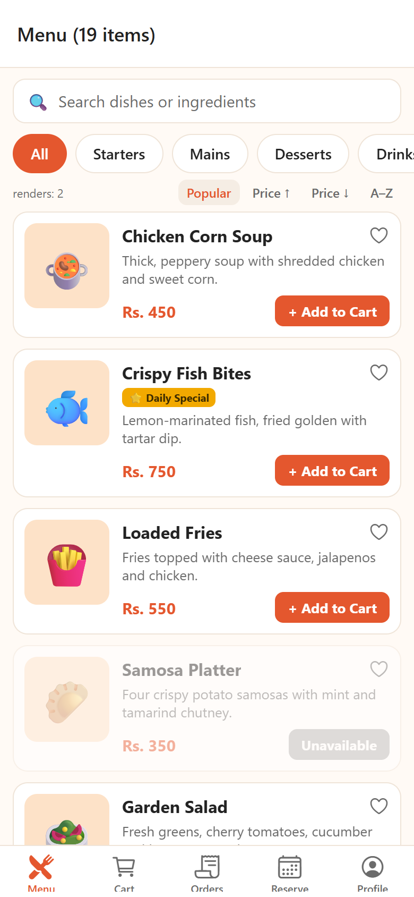
  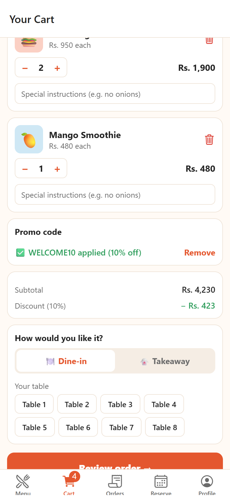
  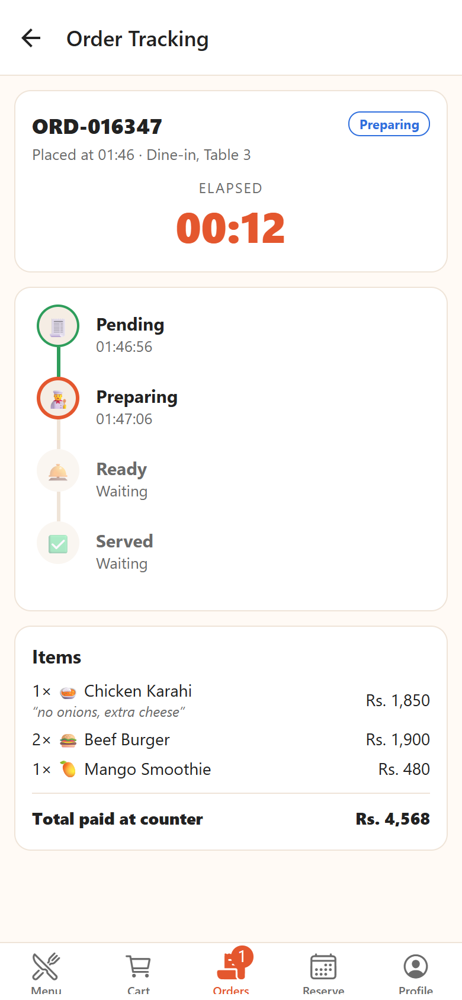
  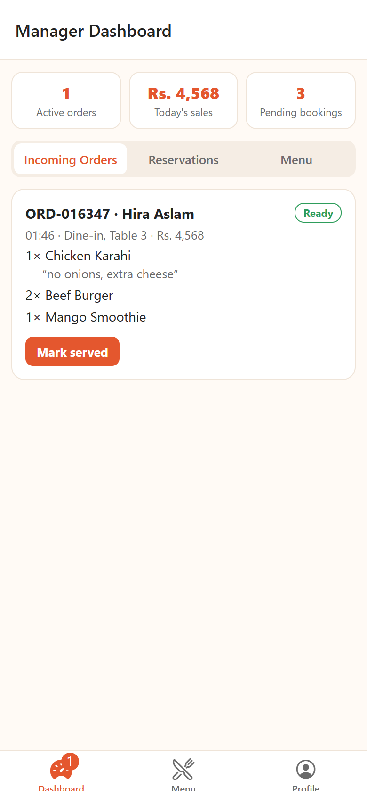
</p>

## Contents

- [Features](#features)
- [Deliverables](#deliverables)
- [Getting started](#getting-started)
- [Demo accounts](#demo-accounts)
- [Hooks used per screen](#hooks-used-per-screen)
- [Project structure](#project-structure)
- [Screenshots](#screenshots)
- [Demo video](#demo-video)
- [Testing](#testing)
- [Notes and answers](#notes-and-answers)
- [Commit history per question](#commit-history-per-question)

## Features

**Customer**
- Login and signup with validation (email format; password of 8+ characters with a digit; matching confirm password; role selector)
- Menu with category chips, "Daily Special" badges, sold-out items greyed out, pull to refresh, and a simulated loading, error and Retry flow
- Debounced search, recent searches, sort by price or name, favourites, and a "Back to top" button
- Cart with quantity stepper, per-item special instructions, promo codes and a live tab badge
- Order summary with subtotal, promo discount, 5% service charge and 15% sales tax
- Dine-in (pick a table) or Takeaway (pick a pickup time)
- Live order tracking: step indicator plus an elapsed timer, advancing Pending → Preparing → Ready → Served at 10, 20 and 30 seconds
- Table reservation: hourly slots 12:00 to 22:00, full slots disabled, validation, confirmation modal, and My Reservations with cancel
- Profile with dark mode for the whole app, and logout that resets the navigation stack

**Restaurant Manager**
- Dashboard tab, visible to managers only, with live stats
- **Incoming Orders:** move orders through the order state machine, or cancel them
- **Reservations:** accept or decline
- **Menu Management:** add items, edit prices, toggle availability. Changes appear on the customer menu immediately

**Everywhere:** bottom tabs with nested stacks, safe-area handling, a light/dark theme on every screen, AsyncStorage persistence and a loading screen until saved data is restored.

## Deliverables

| Item | Location |
|------|----------|
| SRS (Question 1) | [`A1/SRS.pdf`](A1/SRS.pdf) (source: [`A1/source/SRS.html`](A1/source/SRS.html)) |
| UML diagrams (Question 2) | [`A1/UML`](A1/UML): use case, class, sequence, state machine, component (PNG, with Mermaid sources in `A1/UML/src`) |
| Source code (Questions 3 to 10) | [`src/`](src) |
| Screenshots | [`A1/screenshots`](A1/screenshots) |
| Demo video | [`A1/demo/demo.mp4`](A1/demo/demo.mp4) |

## Getting started

### Requirements
- **Node.js 20.19.4 or newer** (22 LTS recommended; tested with Node 25.6) and npm 10+
- For a phone: the **Expo Go** app ([Android](https://play.google.com/store/apps/details?id=host.exp.exponent) / [iOS](https://apps.apple.com/app/expo-go/id982107779))
- For an emulator: Android Studio with an Android Virtual Device, or Xcode's iOS Simulator (macOS only)

### Install and run

```bash
git clone https://github.com/Waqasjan76/Restaurant-App-.git
cd Restaurant-App-
npm install
npx expo start
```

When the Expo dev server starts:

| Target | How |
|--------|-----|
| **Phone (Expo Go)** | Scan the QR code in the terminal with Expo Go (Android) or the Camera app (iOS). Phone and computer must be on the same Wi-Fi network; if not, run `npx expo start --tunnel`. |
| **Android emulator** | Start an AVD from Android Studio's Device Manager, then press **`a`** in the Expo terminal (or run `npm run android`). |
| **iOS simulator** (macOS) | Press **`i`** (or run `npm run ios`). |
| **Web browser** | Press **`w`** (or run `npm run web`). |

Other scripts: `npm test` runs the Jest unit tests. `npx expo export -p web` builds a static web version into `dist/`.

> Saved data (orders, reservations, menu edits, new accounts, theme) survives restarts. To start fresh, clear the app's storage (Android: Settings › Apps › Expo Go › Clear storage; web: clear site data).

## Demo accounts

| Role | Email | Password |
|------|-------|----------|
| Customer | `customer@demo.com` | `Customer123` |
| Manager | `manager@demo.com` | `Manager123` |
| Customer (2nd) | `sara@demo.com` | `Sara12345` |

**Promo codes:** `WELCOME10` (10%), `STUDENT15` (15%), `FEAST20` (20%).
**Reservation demo:** tomorrow 19:00 is fully booked (the slot is shown disabled), and tomorrow 20:00 only has small tables left (disabled for parties above 4).
**Phone format:** `03XX-XXXXXXX`, e.g. `0300-1234567`.

## Hooks used per screen

| Screen / module | useState | useEffect | useRef | useContext | useReducer | useMemo | useCallback | Custom hooks |
|---|:-:|:-:|:-:|:-:|:-:|:-:|:-:|---|
| `LoginScreen` | ✔ | | | ✔ | | ✔ | ✔ | `useForm` |
| `MenuScreen` | ✔ | ✔ | ✔ | ✔ | | ✔ | ✔ | `useDebounce` |
| `MenuItemCard` (`React.memo`) | | | | ✔ | | ✔ | | |
| `ProfileScreen` | | | | ✔ | | ✔ | | |
| `CartScreen` | ✔ | | | ✔ | ✔ (via `CartContext`) | ✔ | | |
| `OrderSummaryScreen` | | | | ✔ | ✔ (via `OrdersContext`) | ✔ | | |
| `ReservationScreen` / `MyReservationsScreen` | ✔ | ✔ | | ✔ | ✔ (via `ReservationsContext`) | ✔ | ✔ | `useReservation` |
| `OrderTrackingScreen` / `MyOrdersScreen` | ✔ | ✔ (intervals) | | ✔ | ✔ (via `OrdersContext`) | ✔ | | |
| `ManagerDashboardScreen` + panels | ✔ | | | ✔ | ✔ (menu, orders, reservations) | ✔ | | `useForm` |
| Context providers | ✔ | ✔ (AsyncStorage) | | | ✔ | ✔ | ✔ | `usePersistedReducer` |

Custom hooks live in [`src/hooks`](src/hooks): `useForm`, `useDebounce`, `useReservation` and `usePersistedReducer` / `usePersistedState`. The context consumer hooks `useAuth`, `useTheme`, `useCart`, `useOrders`, `useMenu` and `useReservations` throw a descriptive error when used outside their provider.

## Project structure

```
├── App.js                      # SafeAreaProvider + all context providers
├── A1/
│   ├── SRS.pdf                 # Question 1
│   ├── UML/                    # Question 2 (PNG + Mermaid sources)
│   ├── screenshots/
│   └── demo/demo.mp4
└── src/
    ├── components/             # MenuItemCard (memo), QuantityStepper, StatusBadge, dashboard/ panels
    ├── context/                # Auth, Theme, Cart, Orders, Menu, Reservations providers + hooks
    ├── data/                   # users, menu, tables, reservations, promoCodes (mock data)
    ├── hooks/                  # useForm, useDebounce, useReservation, usePersistedReducer
    ├── navigation/             # AppNavigator (root stack + loading gate), MainTabs, navigationRef
    ├── reducers/               # cart, orders (state machine), menu, reservations + Jest tests
    ├── screens/                # one file per screen
    ├── theme/palette.js        # light and dark palettes
    └── utils/                  # validation, pricing, date, cross-platform alert
```

## Screenshots

| Q3 Validation | Q3 Submitting (spinner) | Q4 Menu (category) | Q5 Search + render counter |
|:-:|:-:|:-:|:-:|
| 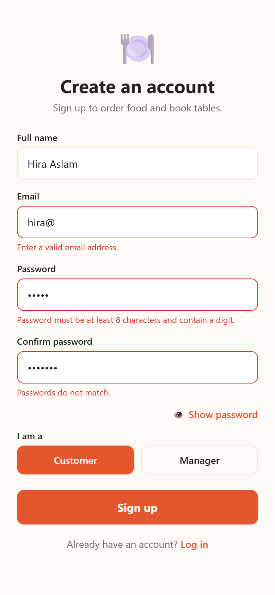 | 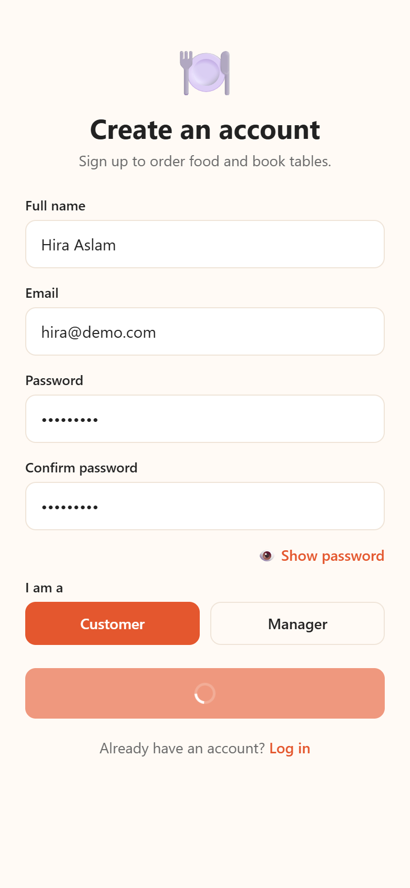 | 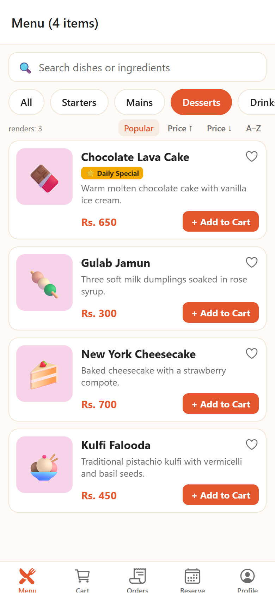 | 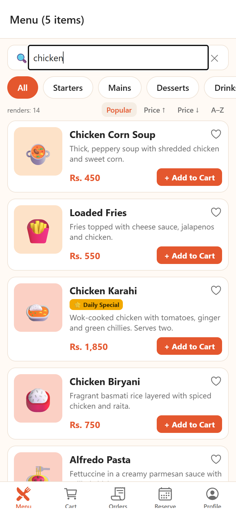 |
| **Q5 Recent searches** | **Q5 Back to top** | **Q5 Empty state** | **Q6 Profile (dark)** |
| 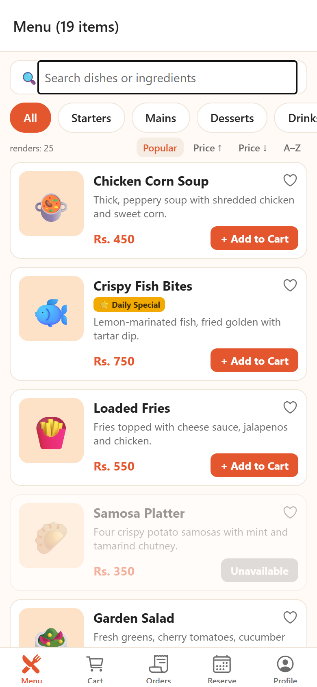 | 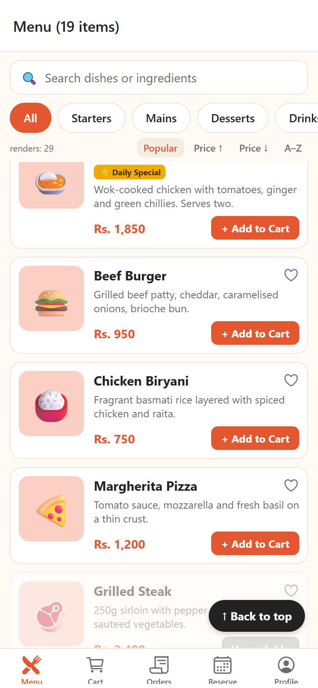 | 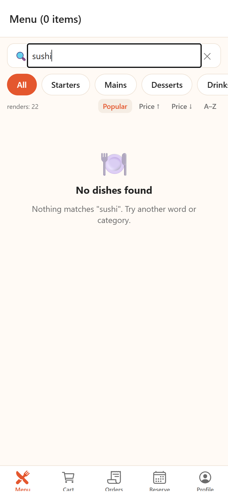 | 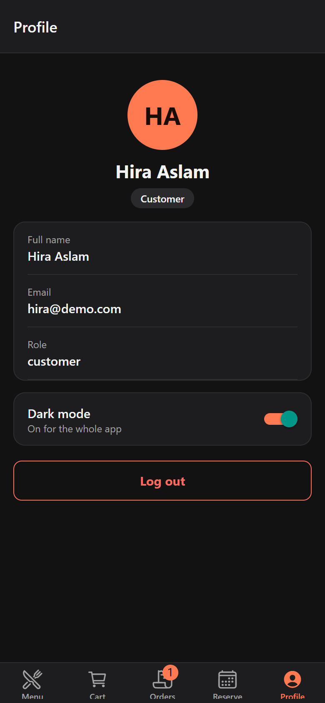 |
| **Q6 Menu (dark)** | **Q7 Invalid promo** | **Q7 Cart** | **Q8 Order summary** |
| 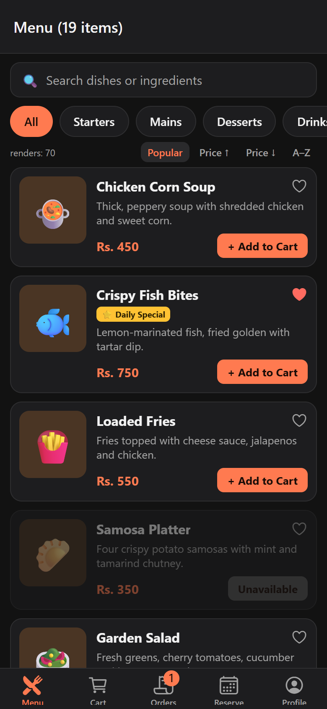 | 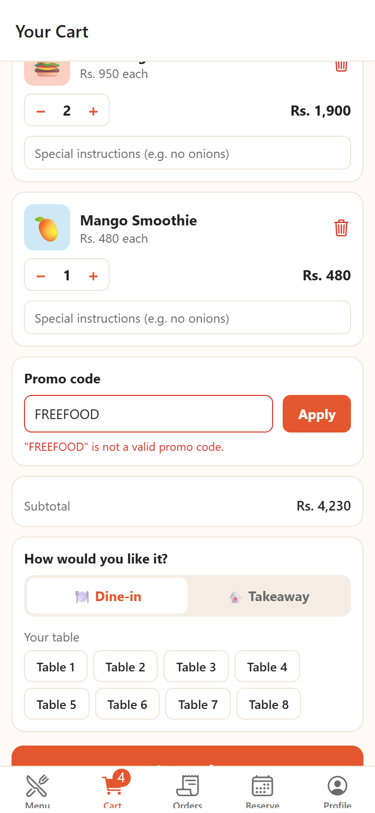 |  | 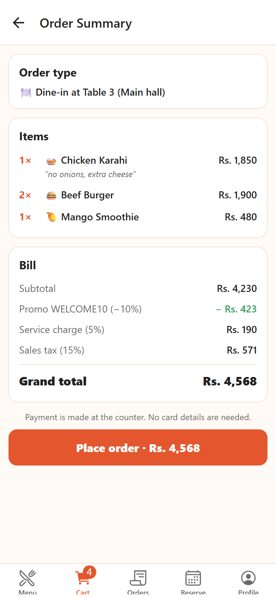 |
| **Q9 Disabled slot (Full)** | **Q9 Validation** | **Q9 Confirm modal** | **Q9 My reservations** |
| 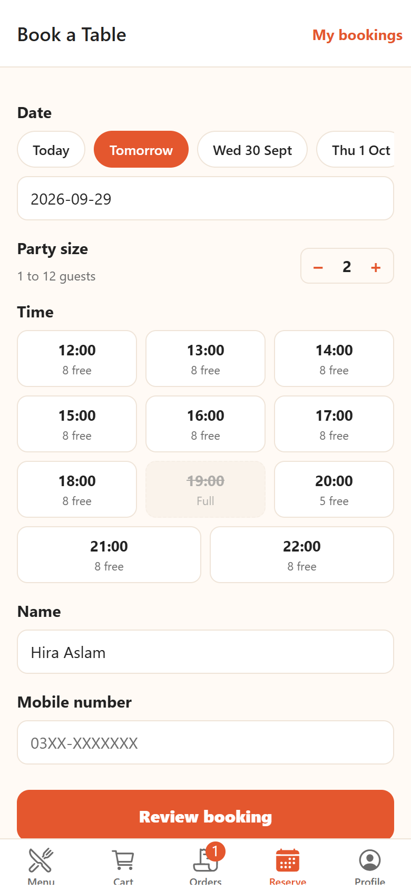 | 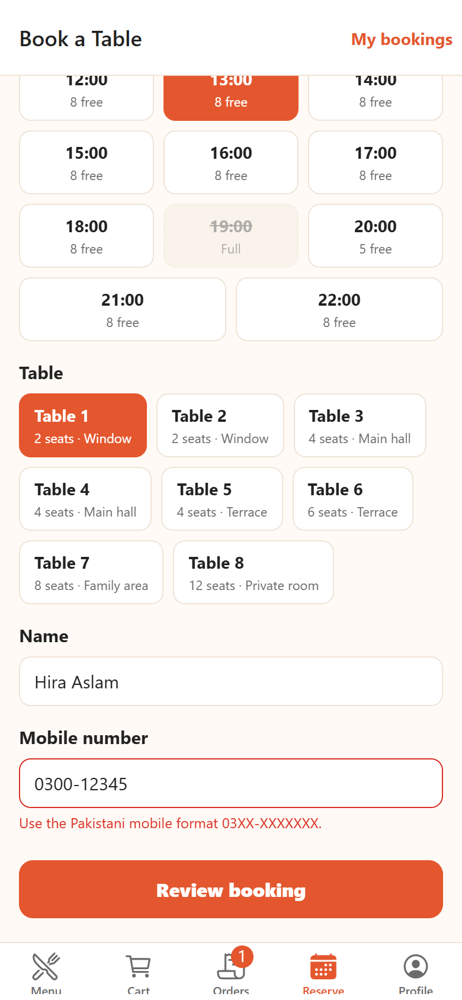 | 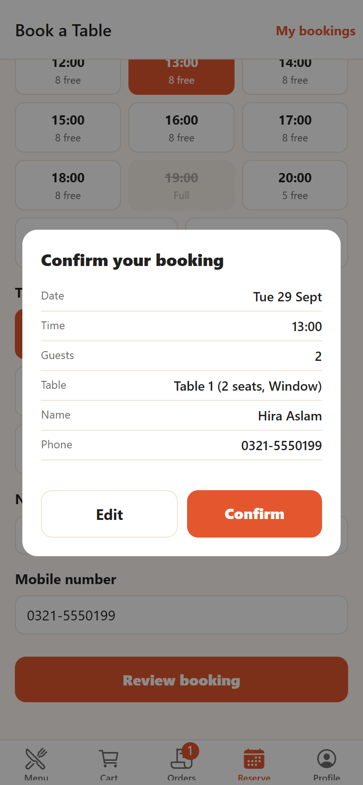 | 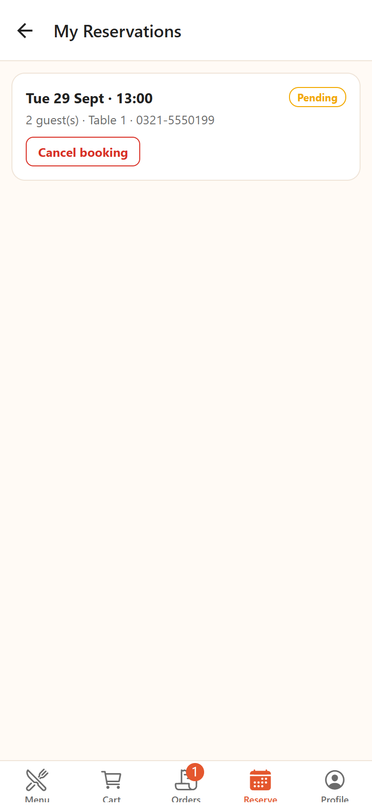 |
| **Q10 Tracking** | **Q10 Dashboard: orders** | **Q10 Dashboard: bookings** | **Q10 Dashboard: menu** |
|  | 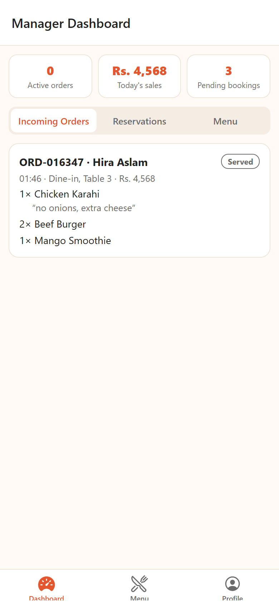 | 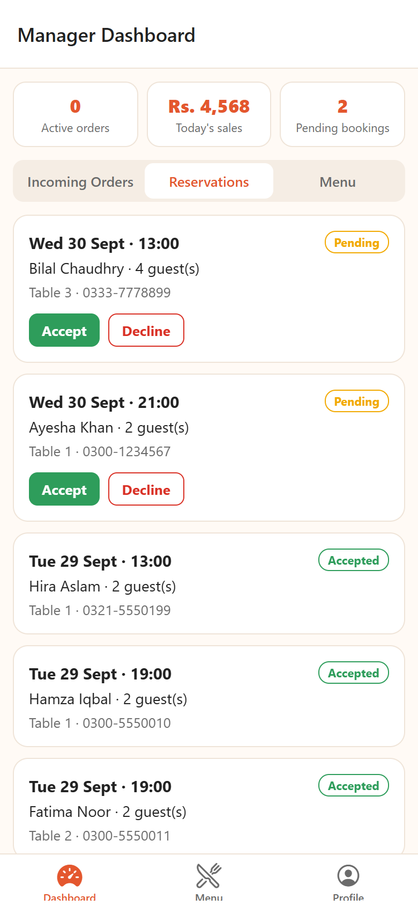 | 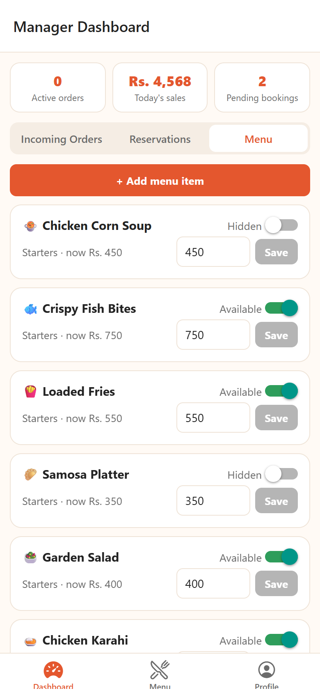 |

**Q8: re-renders when one favourite is toggled** (console output from `MenuItemCard`):

| Before: no `React.memo` (19 renders) | After: `React.memo` + `useCallback` (1 render) |
|:-:|:-:|
| 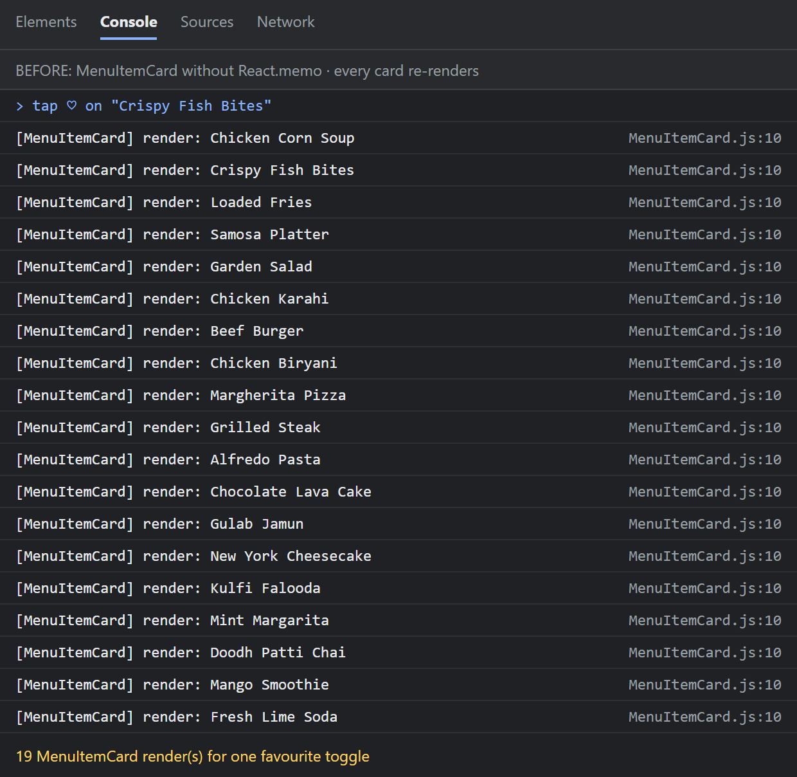 | 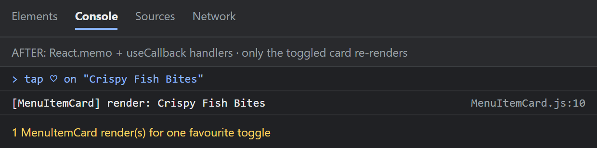 |

## Demo video

▶️ **[Watch the demo (A1/demo/demo.mp4)](A1/demo/demo.mp4)**, under 3 minutes. It shows the complete flow: sign up as a customer, browse and search, add items, apply a promo code, place a dine-in order and watch it progress, reserve a table, switch to dark mode, then log in as the manager, update the same order, accept the booking and edit the menu. The customer menu updates immediately, and the data is still there after a reload.

## Testing

```bash
npm test
```

19 Jest unit tests cover the pure reducers:
- `cartReducer.test.js`: the 10 cases in the table below plus extras. Inputs are deep-frozen to prove immutability.
- `ordersReducer.test.js`: the order state machine (legal and illegal transitions, auto progress, manual override, final states).

The full customer and manager flow was also run end to end on the web build.

## Notes and answers

### Q4: What if the filtering effect had an empty dependency array?

In Question 4 the filtering effect in `MenuScreen` depended on `[selectedCategory, menuItems]`. With an empty array it would run exactly once, right after the first render. At that moment the menu has not loaded yet, so `menuItems` is `[]` and `filteredItems` would be set to an empty list. When the fake request resolves 1.5 seconds later, `menuItems` changes but the effect never runs again, so the list stays empty. Tapping a category chip would also do nothing, because the effect does not re-run when `selectedCategory` changes. The effect would read stale values captured in its first closure. ESLint's `react-hooks/exhaustive-deps` rule warns about exactly this bug. (In Question 8 this state and effect were replaced by a single `useMemo`.)

### Q6: Why Context instead of prop drilling

The logged in user and the theme are needed by almost every screen: the tab bar, the menu cards, the profile page and the manager dashboard. With prop drilling, both values would have to be passed down through `App`, the root stack, the tab navigator and every nested stack, even though those layers never use them. React Navigation screens also receive their props from the navigator, so drilling custom props through it gets awkward quickly. `AuthContext` and `ThemeContext` let any screen read `useAuth()` or `useTheme()` directly, and one `toggleTheme()` restyles the whole app instantly.
**Drawback:** every component that consumes a context re-renders whenever the context value changes. Toggling the theme re-renders every themed screen, even parts that only needed `user`. Keeping the contexts small and separate, and memoising their `value` objects, limits this cost.

### Q7: Cart reducer test cases

Burger = `m7` (Rs. 950), Chai = `m17` (Rs. 200). These are automated in [`src/reducers/__tests__/cartReducer.test.js`](src/reducers/__tests__/cartReducer.test.js).

| # | Action | Initial state | Expected state |
|---|--------|---------------|----------------|
| 1 | `ADD_ITEM` Burger | `items: []` | `items: [Burger x1, note '']` |
| 2 | `ADD_ITEM` Burger | `items: [Burger x1]` | `items: [Burger x2]`, previous state unchanged |
| 3 | `DECREMENT` Burger | `items: [Burger x1, Chai x2]` | `items: [Chai x2]` (removed at zero) |
| 4 | `INCREMENT` Chai | `items: [Burger x1, Chai x2]` | `items: [Burger x1, Chai x3]` |
| 5 | `UPDATE_NOTE` Burger, "no onions" | `items: [Burger x1, note '']` | `items: [Burger x1, note 'no onions']` |
| 6 | `REMOVE_ITEM` Burger | `items: [Burger x4]` | `items: []` |
| 7 | `APPLY_PROMO` " feast20 " | `promoCode: null, discountPercent: 0` | `promoCode: 'FEAST20', discountPercent: 20` |
| 8 | `APPLY_PROMO` "FREEFOOD" | `promoCode: null` | same state object (UI shows "not a valid promo code") |
| 9 | `REMOVE_PROMO` | `promoCode: 'WELCOME10', discountPercent: 10` | `promoCode: null, discountPercent: 0` |
| 10 | `CLEAR_CART` | 2 items + `WELCOME10` | `{ items: [], promoCode: null, discountPercent: 0 }` |

### Q7: useReducer vs useState for the cart

The cart has several pieces of state that change together (items, quantities, notes, promo code, discount) and eight different ways to change them. With `useState`, that logic would be spread across many handlers in different screens, and each one would have to copy arrays correctly. `useReducer` puts every transition in one pure function, which is easy to read, unit test (see the table above) and share through `CartContext` with a single `dispatch`. `useState` would have been enough for a single field such as a quantity counter, or a cart that only supports "add" with no promo codes or notes.

### Q8: When not to use useMemo and useCallback

Memoisation is not free. React has to store the previous value, keep the dependency array and compare it on every render. For cheap work, such as adding two numbers, formatting a price or filtering a list of about twenty items, that overhead can cost more than just recomputing. `useCallback` only helps when the function is passed to a child wrapped in `React.memo`, or used as an effect or hook dependency. Wrapping a handler that goes to a plain `<Pressable>` gains nothing. Memoising also adds bugs when dependency arrays are wrong: stale values, or a memo that never updates. Measure first (for example the render logs in `MenuItemCard`) and optimise only the real hot paths, such as long lists or expensive derived data.

## Commit history per question

Each question has at least one commit on `main`:

| Question | Commit |
|---|---|
| Setup | scaffold Expo project with React Navigation and AsyncStorage |
| Q3 | Login and Signup screen with useState, validation and mock users |
| Q4 | Menu browsing screen with useEffect loading, category filter, pull to refresh |
| Q5 | Search with ref focus and manual debounce, back to top, render counter, recent searches |
| Q6 | AuthContext and ThemeContext, bottom tabs, Profile screen with dark mode, role-based Dashboard tab |
| Q7 | Cart with useReducer, CartContext, promo codes, cart badge and reducer tests |
| Q8 | Order Summary with useMemo totals, memoised MenuItemCard, favourites, sorting via single useMemo |
| Q9 | Custom hooks useForm, useDebounce, useReservation; Table Reservation and My Reservations screens |
| Q10 | Orders context, order tracking timers, manager dashboard, AsyncStorage persistence with loading gate |
| Q2 | UML diagrams (use case, class, sequence, state machine, component) |
| Q1 | Software Requirements Specification (A1/SRS.pdf) |
